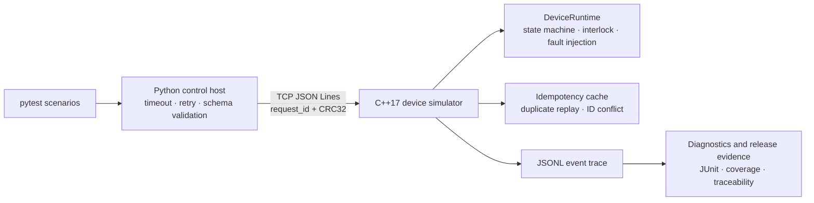
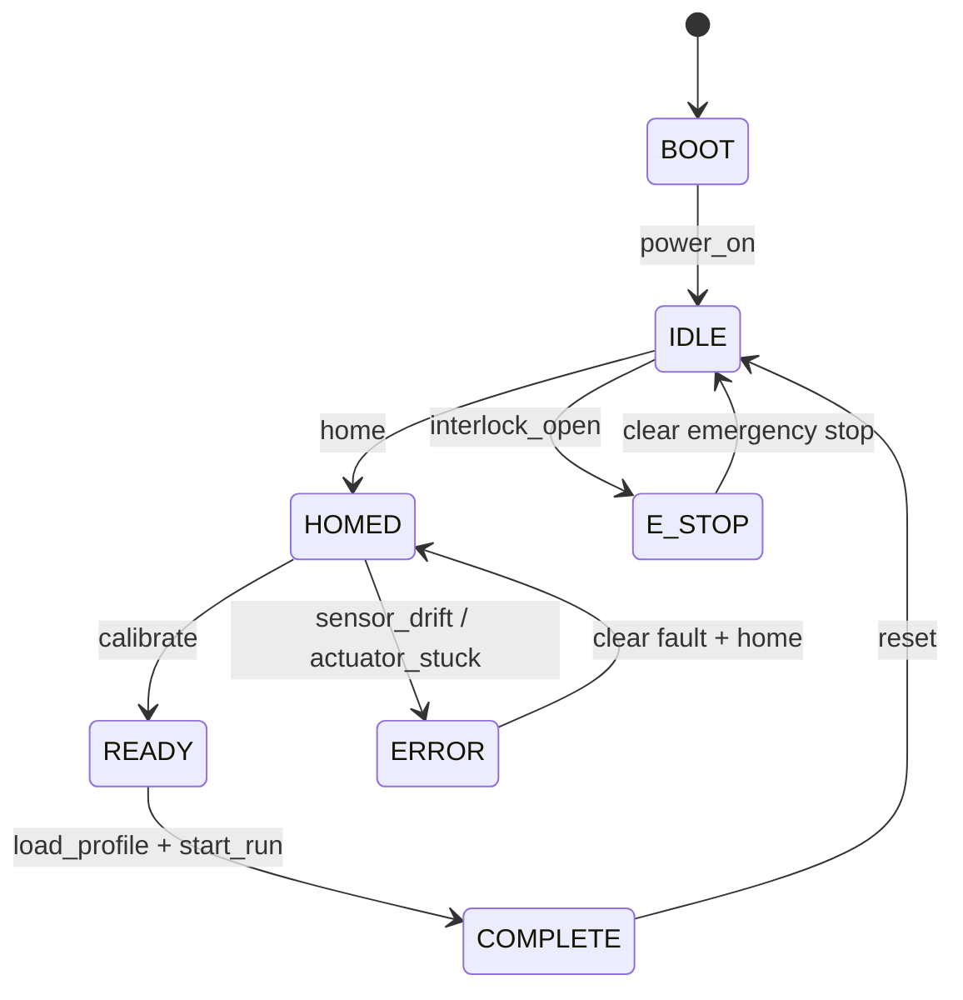

# Edge Device Verification Lab

[](.github/workflows/ci.yml)
[](pyproject.toml)
[](CMakeLists.txt)
[](docs/RELEASE_QUALIFICATION_REPORT.md)

一个可在本地复现的 C++17/Python 设备仿真与系统验证项目。C++ 进程实现设备状态机、TCP JSON Lines 协议、安全联锁、故障注入和幂等响应；Python/pytest 从公开接口完成契约、边界、并发、超时、恢复和发布验证。

> 本项目验证的是通用设备控制软件方法，不代表真实半导体设备、汽车 vECU、生产硬件或行业协议实现。所有状态、数据和故障均为项目自建的确定性测试模型。

## Why this project

目标是提供一条可以被代码、测试和运行证据共同支撑的工程链路：

- C++17：状态机、协议解析、Socket 服务、响应缓存和结构化事件；
- Python：进程编排、强类型契约、超时/重试、诊断与报告；
- 系统验证：异常输入、半包/粘包、重复请求、并发关联和故障恢复；
- 工程工具：CMake、CTest、pytest、Ruff、mypy、coverage 和 GitHub Actions。

## Architecture



测试只通过 TCP 公共接口观察设备，不读取 C++ 对象内部状态。这样，测试方式更接近独立验证工具或诊断客户端。

## Device lifecycle



控制协议另有 `OFFLINE/ONLINE` 和 `LOCAL/REMOTE` 两层状态。远程命令只有在 `ONLINE + REMOTE` 时允许执行。

## Verified behavior

| Layer | Evidence | Local result |
|---|---|---:|
| C++ core | state guards, profile boundaries, interlocks, protocol parser | CTest passed |
| Python unit | Pydantic contracts, diagnostics, reporting, error classification | passed |
| Interface | CRC, malformed input, half/sticky packets, request-ID conflicts | passed |
| Reliability | bounded worker pool, overload response, timeout retry, concurrent idempotency | passed |
| Smart Shelf adapter | v1 telemetry, device isolation, ordering/conflict classification, command authorization | passed |
| System | normal run, E-Stop, actuator stuck, sensor drift and recovery | passed |
| Full Python suite | unit + interface + integration + recovery | 98 passed, 1 Windows-only skip |
| Python coverage | statement + branch coverage | 83.30% |

The result above was rechecked locally on 2026-11-13. A configured workflow is not described as remote CI evidence until it has actually run in GitHub Actions. The Linux workflow enables ASan/UBSan for both CTest and Python-driven simulator tests.

## Quick start

### Linux

```bash
cmake -S . -B build -DCMAKE_BUILD_TYPE=Debug
cmake --build build
ctest --test-dir build --output-on-failure

python -m venv .venv
.venv/bin/python -m pip install -e '.[dev]'
EDGE_SIMULATOR_BIN="$PWD/build/edge_device_simulator" .venv/bin/python -m pytest -q
```

### Windows

```powershell
.\scripts\build_windows.ps1
py -3.12 -m venv .venv
.\.venv\Scripts\python.exe -m pip install -e ".[dev]"
$env:EDGE_SIMULATOR_BIN = "$PWD\build\edge_device_simulator.exe"
.\.venv\Scripts\python.exe -m pytest -q
```

Run the end-to-end demonstrations:

```powershell
.\.venv\Scripts\python.exe scripts\run_demo.py
.\.venv\Scripts\python.exe scripts\run_control_protocol_demo.py
```

The simulator defaults to four workers and a bounded queue of 32 connections. Both are configurable:

```powershell
.\build\edge_device_simulator.exe --workers 4 --queue-capacity 32
```

When the queue is full, new connections receive an explicit `SERVER_BUSY` response.

## Fault injection

Supported deterministic faults:

- `interlock_open`: blocks motion and enters `E_STOP`;
- `actuator_stuck`: causes homing to fail closed;
- `sensor_drift`: causes calibration or a run to fail;
- `response_delay`: exercises timeout classification and stable-ID retry;
- `clear`: clears injected fault flags and active alarms.

Example:

```python
client.inject_fault("response_delay", delay_ms=80)
host = DeviceControlHost(
    DeviceClient(port=client.port, timeout=0.03),
    max_retries=1,
    retry_delay=0.1,
)

response = host._send("status", request_id="retry-status-1")
```

The same request ID is reused after the timeout. If the first request completed, the simulator returns the cached response instead of executing it twice.

## Repository map

- `cpp/`: C++17 runtime, TCP service, protocol and CTest suite;
- `src/edge_validation/`: Python client, control host, contracts and diagnostics;
- `tests/`: unit, interface, concurrent, recovery and system tests;
- `docs/PRODUCT_REQUIREMENTS.md`: requirement baseline;
- `docs/REQUIREMENTS_TRACEABILITY_MATRIX.csv`: requirement-to-test mapping;
- `docs/INTERFACE_PROTOCOL.md`: wire contract;
- `docs/RELEASE_QUALIFICATION_REPORT.md`: current local evidence;
- `docs/KNOWN_LIMITATIONS.md`: explicit non-claims and deferred work.
- `docs/ROADMAP.md`: next engineering increments and their evidence gates.
- `docs/SMART_SHELF_ADAPTER.md`: contract source boundary and covered Smart Shelf scenarios.

## Evidence boundary

Supported claims:

- implemented a C++17 device simulator and Python verification harness;
- validated state guards, fault recovery, TCP framing, retries and idempotency;
- completed one CTest target and 98 Python tests locally (one POSIX signal case skipped on Windows);
- configured cross-platform CI for Windows/Linux and Python 3.11/3.12.

Unsupported claims:

- production hardware or hardware-in-the-loop validation;
- Linux kernel or device-driver development;
- real-time guarantees, industry certification or deployment to a customer site;
- a successful remote CI run before GitHub Actions produces that evidence.
