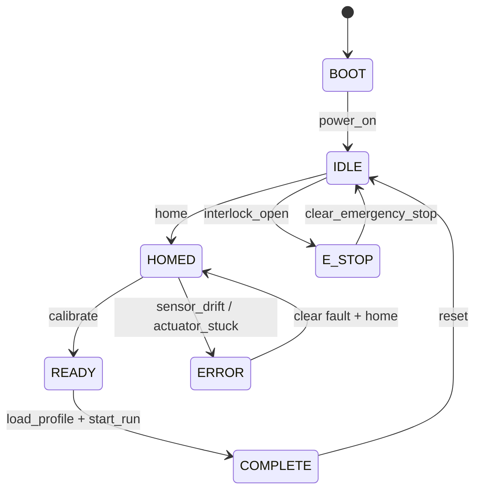
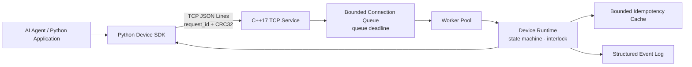

# C++ Device Runtime & SDK — 设备控制软件与智能应用接口

**按模块阅读：** 设备控制与通信见本页；[C++/Python原生推理SDK](inference_sdk/README.md)提供预训练模型对齐、Wheel干净安装和原始时延结果。

[](https://github.com/KristenYue/edge-device-verification-lab/actions/workflows/ci.yml)
[](CMakeLists.txt)
[](pyproject.toml)

## Project Overview

为工业 AI 应用提供可调用的设备软件接口和模拟执行环境。C++17 服务实现设备状态机、安全联锁、TCP 命令协议、并发连接、幂等缓存和结构化事件；Python SDK 负责状态查询、控制请求、超时处理和上层 Agent 接入。

该项目不是以测试脚本为中心的实验仓库。它首先是一个可运行的设备 Runtime：上层应用只能通过公开 TCP 协议观察和控制设备，因而可以被 FastAPI、工业 Agent 或其他研发工具直接复用。

## Application Scenarios

| 场景 | 设备软件能力 |
|---|---|
| 工业 AI 诊断 | Agent 通过 Python SDK 查询设备状态，将 `E_STOP`、联锁和错误信息作为工具观测 |
| 研发联调 | 在真实硬件准备完成前验证命令顺序、状态守卫和故障恢复 |
| 控制接口开发 | 使用稳定 request ID、CRC32 和 JSON Lines 处理 TCP 请求、重试与重复命令 |
| 服务过载保护 | 有界 Worker、连接队列、`SERVER_BUSY` 和 `QUEUE_TIMEOUT` 防止过期命令进入设备核心 |

## Features & Real Demonstration

### 设备生命周期



控制协议还维护通信状态 `OFFLINE/ONLINE` 和控制模式 `LOCAL/REMOTE`。远程命令只有在 `ONLINE + REMOTE` 条件下才允许执行。

### 工业 Agent 接入

[Industrial AI Agent](https://github.com/KristenYue/telecom-network-incident-agent)通过本项目的 `DeviceClient` 调用状态工具。真实模型演示中，C++ Runtime 返回 `E_STOP` 和联锁字段，LLM 随后选择 Runbook 工具并生成诊断建议。

```python
from edge_validation.client import DeviceClient

device = DeviceClient(port=18765, timeout=1)
snapshot = device.status()
print(snapshot.state, snapshot.data)
```

### 4,200 次控制/查询对照

Windows 11、MSVC 14.43 x64 Release，4 个 Worker、32 个队列槽。基线和当前版分别对 `status`、`start_run` 运行三轮，每轮 350 个请求，共 **4,200 次测量请求全部成功**。

| 命令 | 基线吞吐中位数 | 当前吞吐中位数 | 基线 / 当前 P95 中位数 |
|---|---:|---:|---:|
| `status` | 1522.0/s | 1256.8/s | 13.79 / 15.04 ms |
| `start_run` | 986.9/s | 950.2/s | 15.54 / 15.95 ms |

**本轮吞吐量没有提升。** 已验证收益是请求缓存和设备事件常驻数据有界，以及慢连接场景可以在命令进入设备核心前返回 `QUEUE_TIMEOUT`。[原始对照数据](benchmarks/windows-baseline-comparison.json)

## System Architecture



Socket 所有权使用 move-only RAII 从接入线程转交队列和 Worker。设备共享锁覆盖缓存查询、命令执行和响应入账，避免并发检查与执行之间产生重复动作窗口。

## Core Implementation

| 模块 | 实现 |
|---|---|
| Device Runtime | C++17 状态机、状态守卫、安全联锁、配置与运行计数 |
| TCP Protocol | JSON Lines、64 KiB 帧上限、CRC32、稳定 request ID、半包/粘包处理 |
| Concurrent Service | 可配置 Worker Pool、有界连接队列、Socket RAII、`SERVER_BUSY` |
| Queue Deadline | 从 accept 时开始计时，过期返回 `QUEUE_TIMEOUT`，不执行设备命令 |
| Idempotency Cache | 1024 条 FIFO 请求指纹与响应；命中不延长保留时间 |
| Fault Model | `interlock_open`、`actuator_stuck`、`sensor_drift`、`response_delay` |
| Python SDK | Pydantic 响应契约、超时分类、稳定 ID 重试、状态与控制接口 |
| Diagnostics | JSONL 事件、重复序列检查和运行报告 |

## Engineering Results

- 正常完成 `power_on → home → calibrate → load_profile → start_run`。
- 联锁触发后设备进入 `E_STOP`，控制层拒绝启动。
- 相同 request ID 与相同指纹返回缓存结果；相同 ID 不同命令返回冲突。
- 半帧占用单 Worker 时，排队超过 100 ms 的下一连接实测返回 [`QUEUE_TIMEOUT`](benchmarks/windows-queue-deadline.json)。
- 缓存、事件批次和连接队列均设置明确上界；进程重启或 FIFO 驱逐后的幂等边界在文档中公开。
- Windows/Linux CI 构建 C++ Runtime 并运行 Python SDK 集成路径；Linux 支持 ASan/UBSan 构建。

## Industry Applications

- **半导体与 AI 芯片：** 设备控制模拟、联锁诊断、研发上位机和 AI 工具接口。
- **智能汽车：** 智能终端状态机、受控命令接口、重试与重复请求处理。
- **具身智能：** 机器人外设/工作站状态查询、技能前置条件和安全状态反馈。

当前实现是通用仿真设备，不是半导体设备固件、车辆 ECU 或机器人控制器的真实部署。

## Quick Start

### Windows

```powershell
.\scripts\build_windows.ps1
py -3.12 -m venv .venv
.\.venv\Scripts\python.exe -m pip install -e ".[dev]"
$env:EDGE_SIMULATOR_BIN = "$PWD\build\edge_device_simulator.exe"
.\.venv\Scripts\python.exe scripts\run_demo.py
```

直接启动服务：

```powershell
.\build\edge_device_simulator.exe --port 18765 --workers 4 --queue-capacity 32
```

### Linux

```bash
cmake -S . -B build -DCMAKE_BUILD_TYPE=Debug
cmake --build build
ctest --test-dir build --output-on-failure
python -m venv .venv
.venv/bin/python -m pip install -e '.[dev]'
EDGE_SIMULATOR_BIN="$PWD/build/edge_device_simulator" .venv/bin/python scripts/run_demo.py
```

## Evidence & Source Code

| 内容 | 入口 |
|---|---|
| C++ TCP 服务 | [main.cpp](cpp/src/main.cpp) |
| 设备状态机 | [state_machine.hpp](cpp/include/edge/state_machine.hpp) |
| 有界连接队列 | [bounded_queue.hpp](cpp/include/edge/bounded_queue.hpp) |
| Python SDK | [src/edge_validation](src/edge_validation) |
| 协议说明 | [INTERFACE_PROTOCOL.md](docs/INTERFACE_PROTOCOL.md) |
| 运行时加固与 4,200 次对照 | [RUNTIME_HARDENING.md](docs/RUNTIME_HARDENING.md) |
| 原始基准 | [benchmarks](benchmarks) |
| Industrial AI Agent | [业务接入仓库](https://github.com/KristenYue/telecom-network-incident-agent) |

## Validation & Limitations

- 4,200 次结果来自 Windows 本机回环短连接，不代表生产网络吞吐；本轮吞吐量未提升。
- `start_run` 基准模拟状态机与事件写盘，不等待真实执行机构。
- 1024 条 FIFO 缓存被驱逐或进程重启后，同一 ID 可能重新执行；调用方遇到未知结果应先查询状态。
- 设备互斥锁保证单实例内的检查与执行一致性，也使设备操作串行化。
- 日志当前同步写入，文件轮转由部署侧负责；短测资源快照不能证明长期内存趋势。
- 当前为软件模拟器，没有真实硬件时序、电气噪声、现场总线或功能安全认证。

详细验证数量、覆盖率、需求追踪和故障注入见 [Release Qualification](docs/RELEASE_QUALIFICATION_REPORT.md)、[Test Plan](docs/TEST_PLAN.md) 与 [Known Limitations](docs/KNOWN_LIMITATIONS.md)。

## License

[MIT](LICENSE)
