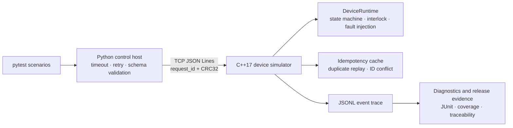
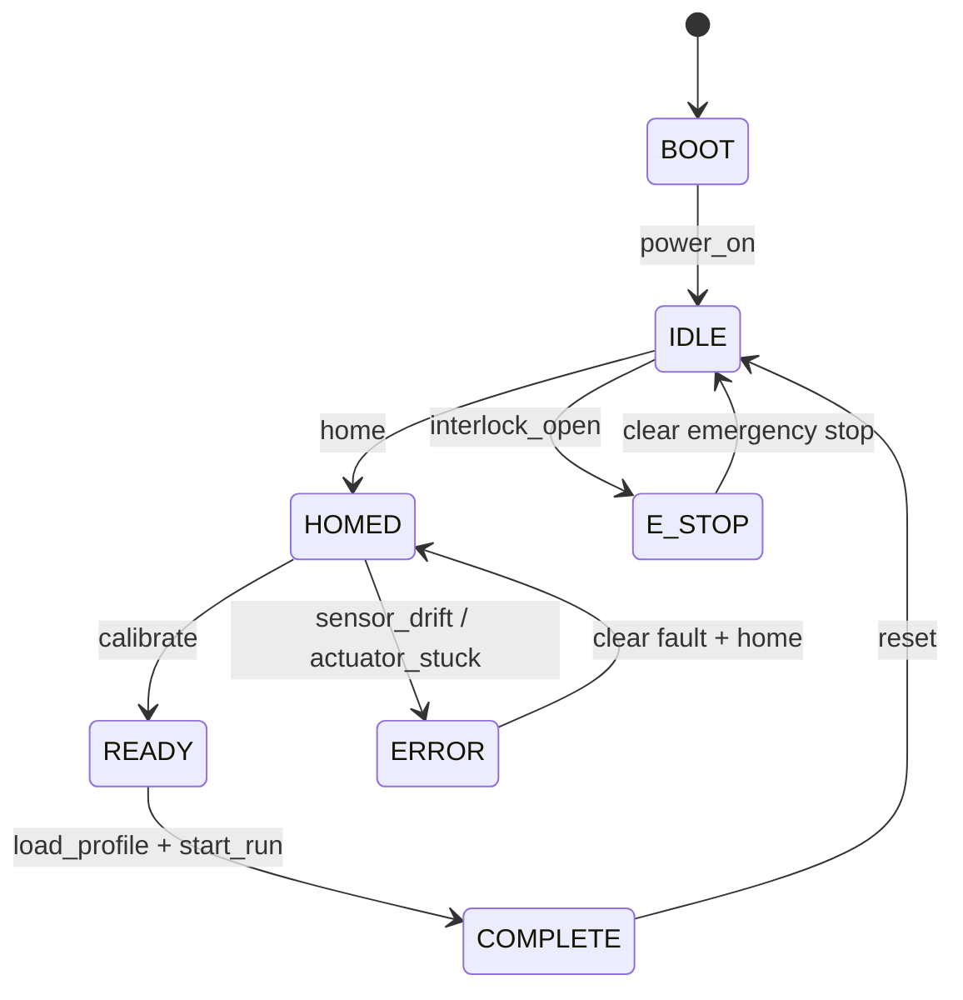

# Edge Device Verification Lab

[](https://github.com/KristenYue/edge-device-verification-lab/actions/workflows/ci.yml)
[](pyproject.toml)
[](CMakeLists.txt)
[](docs/RELEASE_QUALIFICATION_REPORT.md)
[](coverage.xml)
[](LICENSE)

面向边缘设备与 IoT 终端在硬件联调前的软件验证场景，本项目搭建了一套可复现的 C++17/Python 设备控制与自动化验证平台。C++ 端模拟设备运行时、状态机、TCP 通信、安全联锁和故障响应；Python 端作为独立测试上位机，从公共接口验证协议、并发、超时重试、异常恢复和发布质量。

> 核心目标：在设备硬件、固件和上位机并行开发阶段，提前暴露状态转换、通信重试、并发重复执行、过载保护和异常恢复问题，并将结果沉淀为可自动回归、可追踪的工程证据。


## At a glance

| Capability | Implementation | Evidence |
|---|---|---|
| Device runtime | C++17 state machine, safety interlocks and deterministic faults | CTest + TCP system tests |
| Concurrent service | bounded worker pool, synchronized ownership and `SERVER_BUSY` backpressure | saturation and concurrent-idempotency tests |
| Validation host | Python contracts, timeout/retry, CRC32, diagnostics and reporting | 98 pytest cases, 83.30% coverage |
| Smart Shelf | two-device telemetry ordering, isolation, deduplication and command authorization | versioned fixtures + adapter tests |
| Engineering process | CMake, Ruff, mypy, traceability and Windows/Linux CI | qualification report + Actions workflow |

## Engineering scenario

设备控制软件在进入真实硬件联调前，通常需要解决几类高风险问题：命令是否按正确状态顺序执行，网络超时后重试会不会触发重复动作，多客户端接入时状态是否一致，异常发生后系统能否回到安全状态，以及每次修改能否被稳定复验。本项目把这些问题拆成一条完整工程链路：

| Actual engineering problem | Project design |
|---|---|
| 非法命令顺序可能让设备进入错误状态 | C++ 状态机、状态守卫、安全联锁和恢复路径 |
| TCP 半包、粘包、超时和重传可能造成控制异常 | JSON Lines framing、CRC32、稳定请求 ID 和超时重试 |
| 重复或并发控制命令可能执行多次 | 请求指纹、响应缓存和并发幂等测试 |
| 突发连接可能耗尽服务资源 | 有界工作线程池、连接队列和 `SERVER_BUSY` 背压 |
| IoT 遥测可能重复、乱序或跨设备串扰 | Smart Shelf 双设备契约、顺序分类和设备隔离 |
| 修改后缺少统一的发布判断 | pytest/CTest、覆盖率、需求追踪和跨平台 GitHub Actions |

## Architecture



测试只通过 TCP 公共接口观察设备，不读取 C++ 对象内部状态。这样，测试方式更接近独立验证工具或诊断客户端。

## Device lifecycle



控制协议另有 `OFFLINE/ONLINE` 和 `LOCAL/REMOTE` 两层状态。远程命令只有在 `ONLINE + REMOTE` 时允许执行。

## Verified behavior

| Layer | Evidence | Local result |
|---|---|---:|
| C++ core | state guards, profile boundaries, interlocks, protocol parser | CTest passed |
| Python unit | Pydantic contracts, diagnostics, reporting, error classification | passed |
| Interface | CRC, malformed input, half/sticky packets, request-ID conflicts | passed |
| Reliability | bounded worker pool, overload response, timeout retry, concurrent idempotency | passed |
| Smart Shelf adapter | v1 telemetry, device isolation, ordering/conflict classification, command authorization | passed |
| System | normal run, E-Stop, actuator stuck, sensor drift and recovery | passed |
| Full Python suite | unit + interface + integration + recovery | 98 passed, 1 Windows-only skip |
| Python coverage | statement + branch coverage | 83.30% |

The result above was rechecked locally on 2026-11-13. The first remote GitHub Actions matrix also passed on Windows and Linux with Python 3.11/3.12; Linux runs enable ASan/UBSan for both CTest and Python-driven simulator tests.

## Quick start

### Linux

```bash
cmake -S . -B build -DCMAKE_BUILD_TYPE=Debug
cmake --build build
ctest --test-dir build --output-on-failure

python -m venv .venv
.venv/bin/python -m pip install -e '.[dev]'
EDGE_SIMULATOR_BIN="$PWD/build/edge_device_simulator" .venv/bin/python -m pytest -q
```

### Windows

```powershell
.\scripts\build_windows.ps1
py -3.12 -m venv .venv
.\.venv\Scripts\python.exe -m pip install -e ".[dev]"
$env:EDGE_SIMULATOR_BIN = "$PWD\build\edge_device_simulator.exe"
.\.venv\Scripts\python.exe -m pytest -q
```

Run the end-to-end demonstrations:

```powershell
.\.venv\Scripts\python.exe scripts\run_demo.py
.\.venv\Scripts\python.exe scripts\run_control_protocol_demo.py
```

The simulator defaults to four workers and a bounded queue of 32 connections. Both are configurable:

```powershell
.\build\edge_device_simulator.exe --workers 4 --queue-capacity 32
```

When the queue is full, new connections receive an explicit `SERVER_BUSY` response.

## Fault injection

Supported deterministic faults:

- `interlock_open`: blocks motion and enters `E_STOP`;
- `actuator_stuck`: causes homing to fail closed;
- `sensor_drift`: causes calibration or a run to fail;
- `response_delay`: exercises timeout classification and stable-ID retry;
- `clear`: clears injected fault flags and active alarms.

Example:

```python
client.inject_fault("response_delay", delay_ms=80)
host = DeviceControlHost(
    DeviceClient(port=client.port, timeout=0.03),
    max_retries=1,
    retry_delay=0.1,
)

response = host._send("status", request_id="retry-status-1")
```

The same request ID is reused after the timeout. If the first request completed, the simulator returns the cached response instead of executing it twice.

## Repository map

- `cpp/`: C++17 runtime, TCP service, protocol and CTest suite;
- `src/edge_validation/`: Python client, control host, contracts and diagnostics;
- `tests/`: unit, interface, concurrent, recovery and system tests;
- `docs/PRODUCT_REQUIREMENTS.md`: requirement baseline;
- `docs/REQUIREMENTS_TRACEABILITY_MATRIX.csv`: requirement-to-test mapping;
- `docs/INTERFACE_PROTOCOL.md`: wire contract;
- `docs/RELEASE_QUALIFICATION_REPORT.md`: cross-platform qualification evidence;
- `docs/KNOWN_LIMITATIONS.md`: scope assumptions and planned extensions.
- `docs/ROADMAP.md`: next engineering increments and their evidence gates.
- `docs/SMART_SHELF_ADAPTER.md`: contract source boundary and covered Smart Shelf scenarios.

## Verified delivery

当前版本已经形成从实现到发布证据的闭环：

- C++17 设备运行时、Python 验证工具和 Smart Shelf 契约适配器均已实现；
- 状态守卫、故障恢复、TCP framing、超时重试、幂等和过载保护均有自动化测试；
- 本地完成 1 个 CTest 目标和 98 项 Python 测试，Python 覆盖率 83.30%；
- GitHub Actions 已通过 Windows/Linux、Python 3.11/3.12 四组矩阵；
- Linux 流水线同时通过 AddressSanitizer 和 UndefinedBehaviorSanitizer 检查；
- 每项核心需求均可追溯到测试用例和发布证据。
