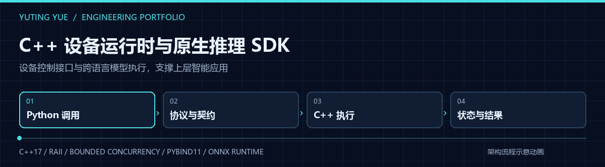
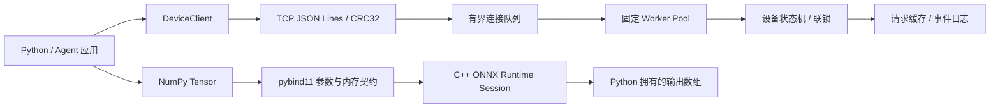

# C++ 设备运行时与原生推理 SDK



<sub>架构流程示意动画 · [静态版本](docs/assets/overview.png) · 动画不作为实测结果。</sub>

[返回技术作品集](https://github.com/KristenYue/KristenYue) · [机器人业务](https://github.com/KristenYue/telecom-network-incident-agent/blob/main/docs/ROBOT_DELIVERY.md) · [原生模型 SDK](https://github.com/KristenYue/edge-device-verification-lab/tree/main/inference_sdk) · [车辆 Agent](https://github.com/KristenYue/telecom-network-incident-agent/blob/main/docs/VEHICLE_ADAPTER.md)


**C++17 · Python · RAII · TCP · CMake · pybind11 · ONNX Runtime CPU**

为上层智能应用提供两类可复用软件能力：**设备控制接口**和**跨语言模型执行接口**。前者管理设备状态、并发连接与请求身份；后者把 Python NumPy 输入交给 C++ ONNX Session 执行，并交还独立拥有内存的输出。

| 您关注的职责 | 优先看什么 | 后续业务 |
|---|---|---|
| **AI 芯片应用 / 模型 SDK / C++ Python 接口** | [原生推理 SDK](inference_sdk/README.md)：Tensor 契约、GIL、生命周期、打包、数值对齐 | [真实模型 + 原生检索 + 设备诊断](https://github.com/KristenYue/telecom-network-incident-agent/blob/main/docs/evidence/native-llm-live.json) |
| **设备软件 / 工业工具链 / 机器人外设接口** | 本页：状态机、Socket RAII、有界并发、幂等缓存和排队期限 | [Agent 设备能力接入](https://github.com/KristenYue/telecom-network-incident-agent) |

## 架构



## 三个核心工程难点

| 工程问题 | 实现 | 能证明的开发能力 |
|---|---|---|
| **Socket 在异常和线程转交时怎样释放** | move-only RAII，接入线程 → 队列 → Worker 逐次移交所有权；队列满返回 `SERVER_BUSY` | 资源生命周期清晰，异常路径无需手工分散关闭。[服务入口](cpp/src/main.cpp) |
| **多连接重试怎样避免重复设备动作** | 设备锁覆盖缓存检查、命令执行和响应入账；相同 ID / 指纹命中缓存，不同指纹报冲突；FIFO 容量 1,024 | 将并发检查和执行放入同一一致性边界。[状态与协议](docs/INTERFACE_PROTOCOL.md) |
| **慢连接与排队请求怎样受控** | 连接队列与 Worker 数有界；从 accept 起记录期限；排队过期先返回 `QUEUE_TIMEOUT`，不进入设备核心 | 资源约束与命令有效期落实在服务层。[队列](cpp/include/edge/bounded_queue.hpp) · [运行时加固](docs/RUNTIME_HARDENING.md) |

## 设备业务：可调用的控制运行时

正常流程为 `power_on → home → calibrate → load_profile → start_run`。通信状态 `ONLINE` 与控制模式 `REMOTE` 是远程命令前提；安全联锁触发后返回 `E_STOP`，控制层拒绝启动。

```python
from edge_validation.client import DeviceClient
device = DeviceClient(port=18765, timeout=1)
snapshot = device.status()
print(snapshot.state, snapshot.data)
```

[工业 Agent](https://github.com/KristenYue/telecom-network-incident-agent)通过这一公共接口读取设备观测，然后检索知识生成解释。模型不拥有绕过设备联锁的接口。

## 可量化结果

| 实验 | 结果 | 环境与证据 |
|---|---|---|
| 设备请求对照 | **4,200 / 4,200 成功** | Windows 11 / MSVC x64 Release，4 Worker、32 队列槽，status / start_run 各 3 轮、每轮 350 次。[原始数据](benchmarks/windows-baseline-comparison.json) |
| 排队期限 | 单 Worker 被半帧连接占用时，下一连接超过配置 100 ms 期限后返回 **QUEUE_TIMEOUT** | 期限配置为 100 ms，不表示精确 100 ms 响应 SLA。[原始响应](benchmarks/windows-queue-deadline.json) |
| 预训练模型对齐 | BGE `3×512` 输出最大绝对误差 **1.53×10⁻⁷** | Windows CPU，单线程，原生 ORT 1.22 / Python ORT 1.32。[原始结果](inference_sdk/benchmarks/windows-bge.json) |
| 动态 Tensor 与异步接口 | 双输入/双输出动态 Batch、`float32/int64` 输出、有界 Worker/等待队列、取消与截止时间测试通过 | 队列满和超时语义由确定性阻塞会话验证；底层推理仍由释放 GIL 的 C++ `Run` 执行。[SDK 测试](inference_sdk/tests/test_inference_sdk.py) |
| 真实模型异步压力 | BGE 24 请求突发下，1/2/4 Worker 吞吐为 **7.79/15.05/25.89 req/s**；4 Worker 执行 P50 升至 **144.82 ms** | 更多 Worker 缩短排队但增加单次执行竞争；保留请求级 submitted/started/completed Trace。[原始结果](inference_sdk/benchmarks/windows-bge-async.json) |
| 跨模型矩阵 | BGE动态Batch 1/4/12、MobileNetV2动态Batch 1/4均与Python ORT输出对齐 | 三个独立试验取中位数；MobileNet相邻Batch排序受本机波动影响，生成参考图只用于多I/O契约验证。[原始结果](inference_sdk/benchmarks/windows-model-matrix.json) |
| CPU 动态 INT8 | 模型缩小 **74.8%**、本机 P50 约 **2.66×**，但冻结检索烟雾集 Recall@1 从 **1.00 降至 0.50** | 保留质量退化结论，不作为默认部署配置；框架量化而非自研算子。[原始结果](inference_sdk/benchmarks/windows-bge-dynamic-int8.json) |
| SDK 交付 | Windows 与 Ubuntu 构建 Wheel、参考图对齐、干净环境安装执行通过 | [Windows 记录](inference_sdk/benchmarks/windows-clean-install.json) · [Ubuntu CI](https://github.com/KristenYue/edge-device-verification-lab/actions/runs/44506857643) |

### 性能对照的完整结论

| 命令 | 基线吞吐中位数 | 当前吞吐中位数 | 基线 / 当前 P95 中位数 |
|---|---:|---:|---:|
| `status` | 1,522.0/s | 1,256.8/s | 13.79 / 15.04 ms |
| `start_run` | 986.9/s | 950.2/s | 15.54 / 15.95 ms |

本轮吞吐量未提升。研发成果是**常驻缓存与连接资源有界、异常请求提前终止、请求身份和设备动作一致性明确**。性能数字来自本机回环短连接；与硬件执行机构耗时分开。

## 原生推理 SDK：接口而非模型调用脚本

Python Tokenizer → 连续 NumPy Tensor → C++ Session → Python 自有输出。Session 独立管理 Env / Options；同步接口在 Run 期间保留输入所有者并释放 GIL；异步接口在提交时复制输入并限制 Worker 与等待队列容量。动态维度、多输入/多输出、常用 dtype、取消和截止时间边界由自动化测试覆盖。详见 [SDK 完整说明](inference_sdk/README.md)。

## 运行方法

Windows：

```powershell
.\scripts\build_windows.ps1
python -m venv .venv
.\.venv\Scripts\python.exe -m pip install -e ".[dev]"
$env:EDGE_SIMULATOR_BIN = "$PWD\build\edge_device_simulator.exe"
.\.venv\Scripts\python.exe scripts\run_demo.py
```

Linux：

```bash
cmake -S . -B build -DCMAKE_BUILD_TYPE=Debug
cmake --build build
ctest --test-dir build --output-on-failure
python -m pip install -e '.[dev]'
EDGE_SIMULATOR_BIN="$PWD/build/edge_device_simulator" python scripts/run_demo.py
```

[SDK 构建、模型导出与对齐](inference_sdk/README.md) · [Ubuntu 原生 SDK 流程](.github/workflows/inference-sdk.yml)

## 源码与工程复盘

[设备状态机](cpp/include/edge/state_machine.hpp) · [Python SDK](src/edge_validation) · [协议](docs/INTERFACE_PROTOCOL.md) · [工程加固](docs/RUNTIME_HARDENING.md) · [基准原始数据](benchmarks)

**Bad Case：** 相同 ID 换载荷、重复请求并发到达、连接半帧占用、缓存驱逐、队列过期。缓存是进程内有界 FIFO，重启或驱逐后不保证历史请求去重；未知控制结果应先查询状态。这些边界影响上层恢复策略。

当前设备为通用软件仿真，推理为 ONNX CPU 执行；分别提供可复现的控制接口和模型 SDK 证据。


---

文档与结果口径：2026-11-19。功能以对应源码和运行记录为准；场景、执行环境和数据来源随结果一并标注。
