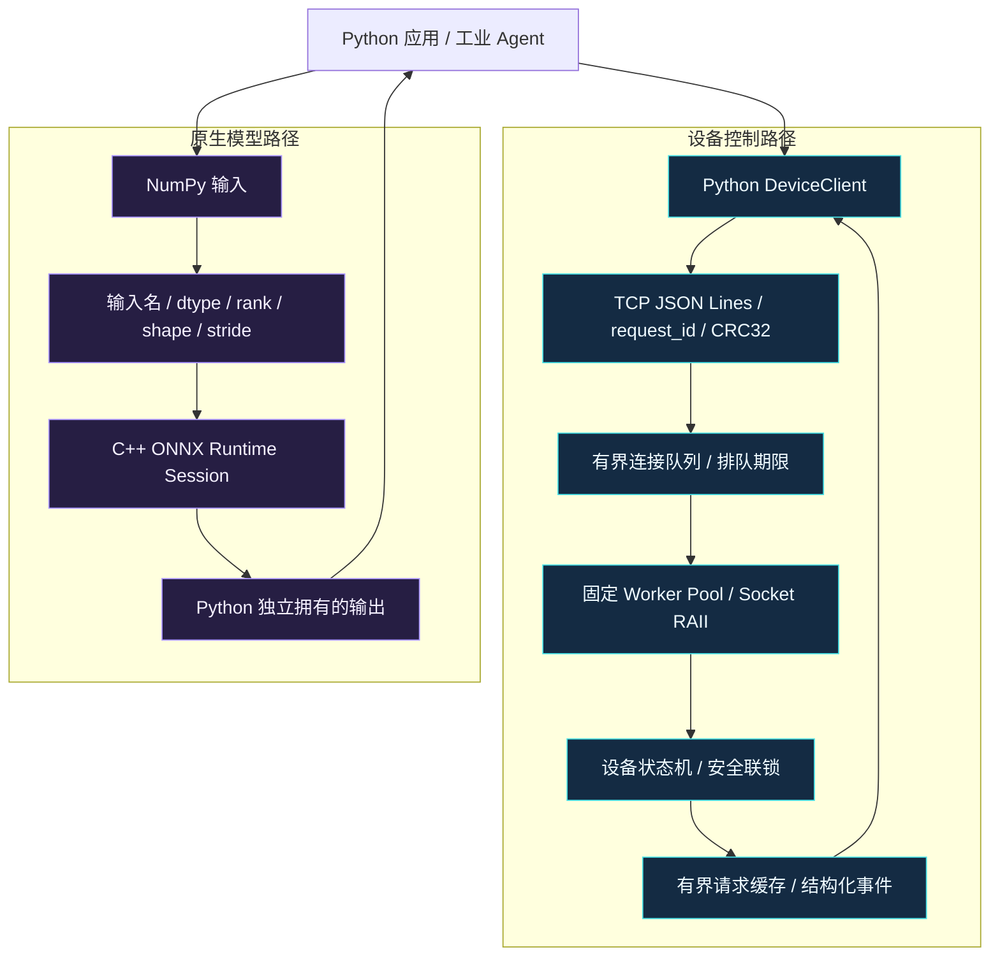
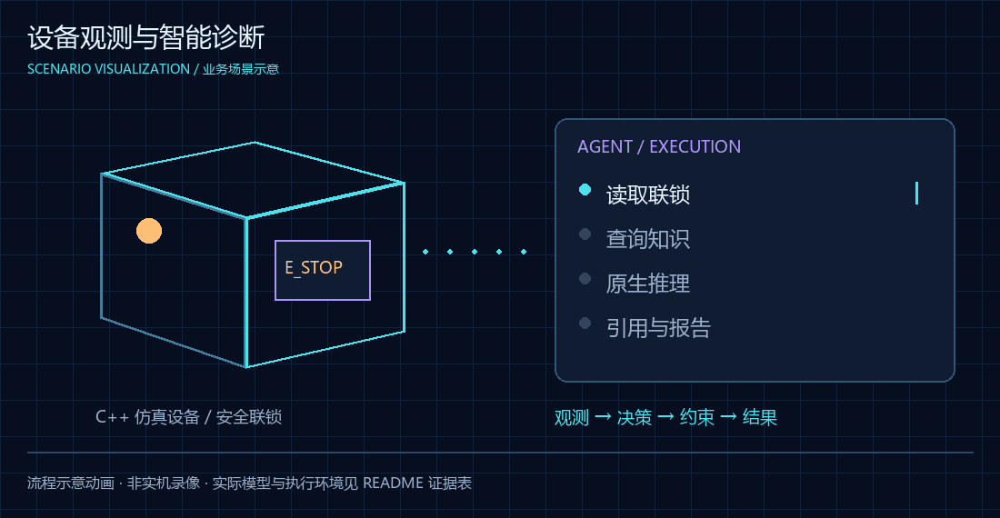
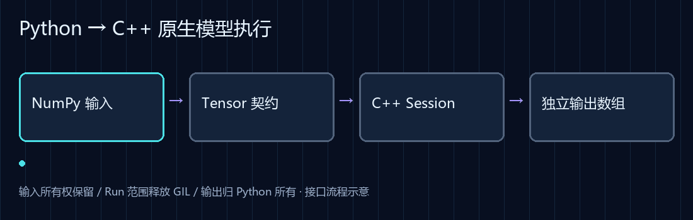
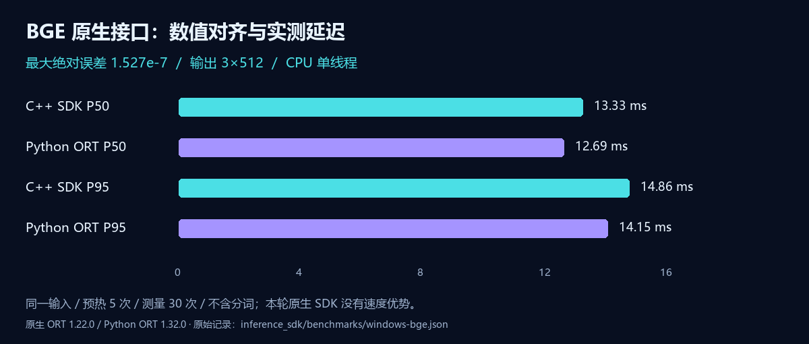

# C++ 设备运行时与原生推理 SDK

**C++17 · Python · TCP · RAII · 有界并发 · pybind11 · ONNX Runtime · CMake**

[个人技术作品集](https://github.com/KristenYue) · [工业 Agent 应用](https://github.com/KristenYue/telecom-network-incident-agent) · [原生 SDK 详细说明](inference_sdk/README.md)

为智能应用提供两类可复用的软件接口：

- **设备运行时**：管理设备状态、通信请求、安全联锁、并发连接与请求身份。
- **原生推理 SDK**：通过 Python NumPy 调用 C++ ONNX Session，完成输入检查、模型执行和输出交付。

项目连接了**上层 AI 应用、设备控制软件与原生模型执行**。业务应用使用公开接口调用能力，底层分别管理设备状态与模型资源生命周期。

---

## 按研发职责阅读

| 关注方向 | 建议阅读顺序 | 核查重点 |
|---|---|---|
| **AI 芯片应用 / 模型 SDK / 跨语言软件** | 原生推理场景 → Tensor 与内存设计 → 数值对齐 → Wheel 交付 | pybind11、ONNX Runtime、GIL、对象生命周期、异常与打包 |
| **设备系统软件 / 工业研发工具链** | 设备场景 → 状态机 → 并发与请求一致性 → 资源约束 | C++17、Socket RAII、TCP 协议、状态守卫、有界队列 |
| **机器人 / 智能终端应用软件** | 设备公共接口 → Agent 接入 → 超时与未知结果处理 | 状态查询、前置条件、控制约束、重复请求和上层恢复策略 |

---

## 核心结果一览

| 已验证成果 | 实际结果 | 证据 |
|---|---|---|
| **设备控制与查询对照** | **4,200 / 4,200 请求成功** | [完整对照数据](benchmarks/windows-baseline-comparison.json) |
| **过期请求隔离** | 半帧连接占用 Worker 时，排队超过配置期限的请求返回 **`QUEUE_TIMEOUT`** | [原始响应](benchmarks/windows-queue-deadline.json) |
| **设备资源有界** | 并发实验配置 **4 Worker / 32 队列槽**；请求缓存容量 **1,024 条** | [运行时设计与实验](docs/RUNTIME_HARDENING.md) |
| **预训练 BGE 数值对齐** | 输出 **3×512**，C++ SDK 与 Python ORT 最大绝对误差 **1.53×10⁻⁷** | [原始数值与延迟](inference_sdk/benchmarks/windows-bge.json) |
| **Windows 干净安装** | 只安装 NumPy 与 SDK Wheel，参考计算图最大绝对误差 **0** | [安装验证](inference_sdk/benchmarks/windows-clean-install.json) |
| **Ubuntu 原生交付** | Wheel 编译、参考图执行、独立虚拟环境安装执行通过 | [Linux 云端验收](https://github.com/KristenYue/edge-device-verification-lab/actions/runs/44506857643) |
| **真实模型联合应用** | LLM 经 **2 次工具调用**完成设备观测、原生知识检索与诊断生成 | [跨仓库联合轨迹](https://github.com/KristenYue/telecom-network-incident-agent/blob/main/docs/evidence/native-llm-live.json) |

设备吞吐对照和 BGE 原生封装本轮均未获得提速。工程成果集中于**资源约束、并发一致性、跨语言接口、生命周期安全与可安装交付**，完整性能数据保留在下文。

---

## 系统架构与模块边界



两条路径分别管理资源和契约：设备运行时管理状态与命令；推理 SDK 管理模型会话与 Tensor。上层应用将二者组合为设备诊断等业务。

---

## 场景一：设备状态查询、控制与智能诊断



> 动画为设备诊断业务示意。设备由 C++ 软件仿真，展示设备观测、知识工具和上层报告之间的关系；具体接口与运行结果见下文。

### 解决的问题

真实硬件联调前，上层软件需要一个具有明确状态、命令约束和故障响应的设备接口：

- 当前状态是否允许启动？
- 联锁触发后控制请求怎样返回？
- 请求超时后重试是否会重复执行？
- 多个连接同时访问设备，状态检查与执行怎样保持一致？
- 慢连接与排队请求怎样受到资源和时间约束？

### 设备业务流程

正常命令链：

```text
power_on → home → calibrate → load_profile → start_run
```

远程控制同时受通信状态、控制模式和设备状态约束。安全联锁触发后进入 `E_STOP`，控制层拒绝启动。

上层通过公共 Python SDK 调用：

```python
from edge_validation.client import DeviceClient

device = DeviceClient(port=18765, timeout=1)
snapshot = device.status()

print(snapshot.state, snapshot.data)
```

[工业 Agent](https://github.com/KristenYue/telecom-network-incident-agent)使用这一接口读取设备状态，将实际观测交给模型与知识工具，生成带来源的诊断结果。

### 设计一：资源所有权明确转交

Socket 使用 **move-only RAII**，在接入线程、连接队列和 Worker 之间转移所有权。

```text
accept
  → Socket 对象取得所有权
  → 移入有界队列
  → Worker 取得所有权
  → 正常结束或异常退出时释放
```

这样把资源释放绑定到对象生命周期，减少异常分支中遗漏关闭或重复关闭的风险。

[服务源码](cpp/src/main.cpp)

### 设计二：并发检查与执行保持一致

请求身份由稳定 `request_id` 与请求指纹共同约束：

| 请求情况 | 处理方式 |
|---|---|
| 同 ID、同指纹 | 返回缓存响应 |
| 同 ID、不同指纹 | 返回冲突 |
| 新请求且状态允许 | 执行并记录响应 |
| 新请求但状态不允许 | 返回状态或联锁错误 |

设备互斥边界覆盖**缓存检查 → 命令执行 → 响应入账**，避免两个连接同时检查通过后重复执行动作。

请求缓存为 **1,024 条 FIFO**，命中不延长保留时间。缓存驱逐与进程重启后的身份边界明确记录，供调用方设计恢复策略。

[协议与请求身份](docs/INTERFACE_PROTOCOL.md) · [运行时设计](docs/RUNTIME_HARDENING.md)

### 设计三：服务资源与命令有效期有界

- Worker 数量可配置。
- 等待连接进入固定容量队列。
- 队列满返回 `SERVER_BUSY`。
- 排队期限从 accept 时开始计算。
- 过期请求返回 `QUEUE_TIMEOUT`，不进入设备核心。
- 协议设置 **64 KiB 帧上限**，处理 TCP 半包与粘包。

**实测分支：** 单 Worker 被半帧连接占用时，下一连接超过配置的 100 ms 排队期限后返回 `QUEUE_TIMEOUT`。100 ms 是期限配置，不作为精确响应 SLA。

[有界队列](cpp/include/edge/bounded_queue.hpp) · [超时实测响应](benchmarks/windows-queue-deadline.json)

### 设备性能对照

Windows 11 / MSVC 14.43 x64 Release，4 Worker、32 队列槽。

基线与当前版分别对 `status`、`start_run` 测量三轮，每轮 350 次，共 **4,200 次测量请求全部成功**。

| 命令 | 基线吞吐中位数 | 当前吞吐中位数 | 基线 P95 中位数 | 当前 P95 中位数 |
|---|---:|---:|---:|---:|
| `status` | 1,522.0/s | 1,256.8/s | 13.79 ms | 15.04 ms |
| `start_run` | 986.9/s | 950.2/s | 15.54 ms | 15.95 ms |

本轮没有取得吞吐提升。新增机制验证了**有界常驻数据、排队过期隔离和请求一致性**，不将资源与异常行为改善改写为速度提升。

[原始对照数据](benchmarks/windows-baseline-comparison.json)

---

## 场景二：Python 调用 C++ 原生模型



> 动画为接口与所有权流程示意：输入由 Python 提供，C++ 执行 ONNX 模型，输出交由 Python 独立持有。

### 解决的问题

模型执行接口不仅需要“跑出结果”，还需要回答：

- 输入类型和内存布局是否正确？
- Python 对象在原生执行期间是否仍然有效？
- 何时可以释放 GIL？
- Session 销毁后，输出是否仍可读取？
- 原生执行失败如何映射为 Python 异常？
- 安装到另一台机器后是否仍能找到运行库？

### 核心接口设计

| 设计点 | 实现方式 | 工程作用 |
|---|---|---|
| **Session 生命周期** | C++ 独立持有 Env、SessionOptions 与 Session | 保持原生资源依赖及析构顺序 |
| **输入契约** | 接受 C-contiguous `float32 / int64`，校验输入名、rank 和固定维度 | 拒绝隐式转换与不符合模型定义的输入 |
| **输入所有权** | Run 期间保留 NumPy 对象引用 | 防止原生调用期间输入内存失效 |
| **GIL 边界** | 仅在原生 Run 范围释放 GIL | 将 Python 对象操作与原生执行明确分开 |
| **输出所有权** | 复制到 Python 拥有的数组 | 避免 ORT 临时对象或 Session 析构造成悬空引用 |
| **异常转换** | 参数错误使用 `ValueError`，ORT 错误映射为 `InferenceError` | 供调用方区分契约错误与执行错误 |
| **安装交付** | CMake / scikit-build-core 构建 Wheel，携带运行库 | 在干净环境验证依赖闭合 |

[原生封装源码](inference_sdk/bindings/session.cpp) · [SDK 详细说明](inference_sdk/README.md)

### 使用接口

```python
from edge_ai_sdk import InferenceSession

session = InferenceSession("model.onnx")
print(session.model_info())

outputs = session.run({"input": input_array})
```

调用者必须在执行期间保持输入内容稳定，不应由其他线程并发修改同一输入数组。

### 预训练 BGE 数值对齐与延迟

模型：`BAAI/bge-small-zh-v1.5`。导出 CLS + L2 归一化 ONNX，支持动态 batch / sequence；Python 负责分词。

| 项目 | C++ SDK | Python ORT | 测量口径 |
|---|---:|---:|---|
| 输入形状 | 3×15 | 3×15 | 相同输入 |
| 输出形状 | 3×512 | 3×512 | 相同模型 |
| 最大绝对误差 | **1.527×10⁻⁷** | 参考 | 数值对齐 |
| P50 | 13.33 ms | 12.69 ms | 单线程、预热 5 次、测量 30 次 |
| P95 | 14.86 ms | 14.15 ms | 不含分词 |



原生 ORT 为 1.22.0，Python ORT 为 1.32.0，版本差异保留在原始结果中。本轮没有原生调用速度优势；交付价值是**模型接口契约、内存安全、可安装封装和业务复用**。

[原始测量](inference_sdk/benchmarks/windows-bge.json)

### 从组件到业务的证据链

| 阶段 | 已完成验证 | 原始入口 |
|---|---|---|
| 参考计算图 | 与 NumPy 最大绝对误差 0；非法 dtype / shape / stride 拒绝；输出生命周期验证 | [参考验证](inference_sdk/benchmarks/windows-reference.json) |
| Windows 干净环境 | 仅 NumPy + SDK Wheel，无 Python ORT / Torch / Transformers，参考图误差 0 | [安装记录](inference_sdk/benchmarks/windows-clean-install.json) |
| Ubuntu 干净环境 | 原生 Wheel 编译、参考图执行、独立虚拟环境安装成功 | [Linux 验收](https://github.com/KristenYue/edge-device-verification-lab/actions/runs/44506857643) |
| 预训练模型 | BGE 原生执行与 Python ORT 数值对齐 | [模型记录](inference_sdk/benchmarks/windows-bge.json) |
| 知识工具 | NativeEmbedder 接入工业知识检索 | [检索结果](https://github.com/KristenYue/telecom-network-incident-agent/blob/main/docs/evidence/native-retrieval.json) |
| 完整应用 | 真实 LLM 查询 C++ 设备，再调用原生知识工具生成诊断 | [联合轨迹](https://github.com/KristenYue/telecom-network-incident-agent/blob/main/docs/evidence/native-llm-live.json) |

---

## 模块与源码

| 模块 | 职责 | 入口 |
|---|---|---|
| C++ 服务 | 连接接入、Worker、协议与资源管理 | [main.cpp](cpp/src/main.cpp) |
| 设备状态机 | 状态转换、命令前提与故障响应 | [state_machine.hpp](cpp/include/edge/state_machine.hpp) |
| 有界队列 | 容量限制与跨线程连接移交 | [bounded_queue.hpp](cpp/include/edge/bounded_queue.hpp) |
| Python SDK | 设备调用、响应契约、超时与重试 | [edge_validation](src/edge_validation) |
| 原生模型封装 | Tensor 契约、Session、GIL 与输出 | [session.cpp](inference_sdk/bindings/session.cpp) |
| 模型导出 | BGE ONNX 导出 | [export_embedding.py](inference_sdk/examples/export_embedding.py) |
| 数值与时延 | 预训练模型对齐、预热与分位数 | [verify_embedding.py](inference_sdk/examples/verify_embedding.py) |
| 干净安装 | 安装后参考图执行 | [verify_installed_wheel.py](inference_sdk/examples/verify_installed_wheel.py) |

---

## 运行方法

### Windows：设备运行时

```powershell
.\scripts\build_windows.ps1

python -m venv .venv
.\.venv\Scripts\python.exe -m pip install -e ".[dev]"

$env:EDGE_SIMULATOR_BIN = "$PWD\build\edge_device_simulator.exe"
.\.venv\Scripts\python.exe scripts\run_demo.py
```

直接启动服务：

```powershell
.\build\edge_device_simulator.exe --port 18765 --workers 4 --queue-capacity 32
```

### Linux：设备运行时

```bash
cmake -S . -B build -DCMAKE_BUILD_TYPE=Debug
cmake --build build
ctest --test-dir build --output-on-failure

python -m pip install -e '.[dev]'

EDGE_SIMULATOR_BIN="$PWD/build/edge_device_simulator" \
python scripts/run_demo.py
```

### Windows：原生 SDK

先取得官方 ONNX Runtime CPU C/C++ 包，目录包含 `include/` 与 `lib/`：

```powershell
.\inference_sdk\build_windows.ps1 -OrtRoot <ORT发行包目录>

.\.venv-sdk\Scripts\python.exe inference_sdk/examples/verify_session.py `
  --output .runtime/sdk-reference.json
```

Linux 构建与干净安装命令见 [SDK 验收流程](.github/workflows/inference-sdk.yml)。

预训练模型需独立取得权重，并准备对应 Tokenizer；完整步骤见 [SDK README](inference_sdk/README.md)。

---

## 工程复盘与关键 Bad Case

| 问题 | 修正或约束 | 工程意义 |
|---|---|---|
| 同 ID 携带不同命令 | 请求指纹冲突拒绝 | 请求身份不能只检查字符串 ID |
| 两个连接同时重试 | 缓存检查、执行、入账位于同一锁边界 | 避免检查与执行之间的重复动作窗口 |
| 半帧连接占用 Worker | 有界并发、排队期限与明确错误返回 | 慢连接影响受到容量与期限约束 |
| 缓存驱逐或进程重启 | 明确进程内 FIFO 的保留范围 | 上层遇到未知结果先查询状态 |
| 原生临时输出被析构 | 输出复制为 Python 自有数组 | 输出不依赖原生临时对象生命周期 |
| Linux 编译成功但运行库加载失败 | 安装 SONAME 别名，并在全新环境执行参考图 | 构建成功与可安装运行分别验收 |

---

## 证据与设计文档

- [设备接口协议](docs/INTERFACE_PROTOCOL.md)
- [运行时加固与性能对照](docs/RUNTIME_HARDENING.md)
- [设备基准原始数据](benchmarks)
- [原生 SDK 与测量口径](inference_sdk/README.md)
- [原生 SDK Linux 构建](.github/workflows/inference-sdk.yml)
- [工业 Agent 联合应用](https://github.com/KristenYue/telecom-network-incident-agent)

<details>
<summary>执行环境与适用范围</summary>

设备为通用软件仿真，性能测量来自 Windows 本机回环短连接，不包含真实执行机构耗时。设备锁保证单实例内状态一致性，同时使设备核心操作串行化。

原生 SDK 当前使用 ONNX Runtime CPU Execution Provider。参考图、预训练 BGE 和业务联合运行分别记录，不将参考图耗时外推为预训练模型或目标芯片性能。

缓存为进程内有限 FIFO，不承担跨重启的永久去重；外部控制结果未知时，需要上层查询或人工处理。

</details>

---

[MIT License](LICENSE)
