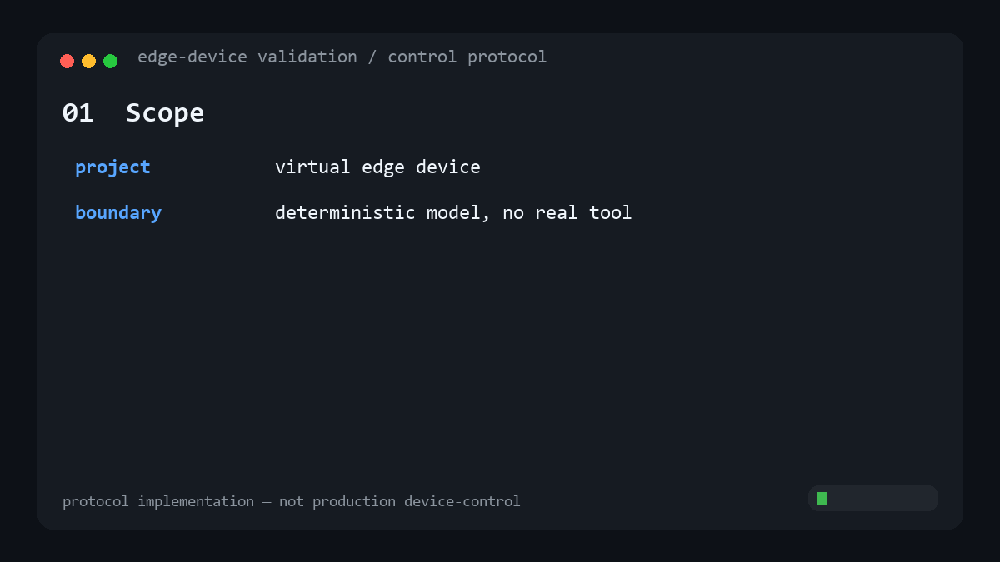
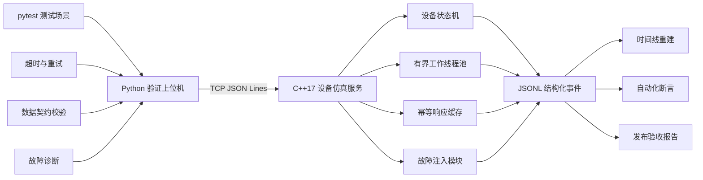
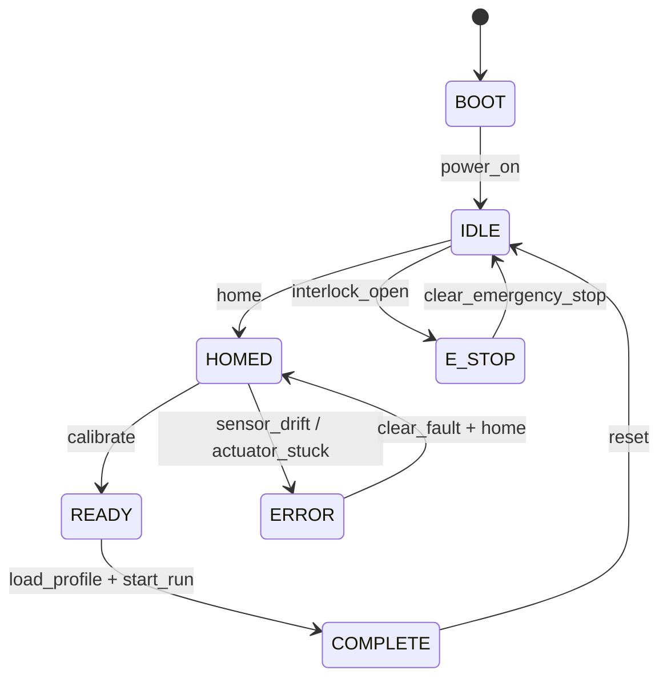

# 边缘设备仿真与验证平台

[](https://github.com/KristenYue/edge-device-verification-lab/actions/workflows/ci.yml)
[](pyproject.toml)
[](CMakeLists.txt)
[](docs/RELEASE_QUALIFICATION_REPORT.md)
[](docs/RELEASE_QUALIFICATION_REPORT.md)
[](LICENSE)

面向边缘设备与 IoT 终端在**真实硬件联调前阶段**的软件验证需求，构建的一套 C++17/Python 设备仿真与自动化验证平台。

C++ 端模拟设备运行时、状态机、TCP 服务、安全联锁和故障响应；Python 端作为独立测试上位机，通过公共接口执行协议验证、故障注入、并发测试、超时重试、异常恢复和发布验收。

> 核心目标：在设备硬件、固件和上位机并行开发阶段，提前发现状态转换、重复命令、通信超时、并发过载和故障恢复问题，并将这些问题沉淀为可重复执行的自动化回归证据。



---

## 10 秒了解项目

```text
Python 测试场景
      │
      │ TCP + JSON Lines
      │ request_id + CRC32
      ▼
C++17 设备仿真服务
      │
      ├── 设备状态机与安全联锁
      ├── 有界工作线程池
      ├── 请求指纹与幂等缓存
      └── 确定性故障注入
      │
      ▼
结构化事件日志
      │
      ├── pytest 自动断言
      ├── 故障诊断与时间线重建
      └── 发布验收报告
```

平台重点解决三个工程问题：

1. **设备命令如何受到状态与安全条件约束；**
2. **网络超时重试如何避免状态修改命令重复执行；**
3. **并发连接超过处理能力时如何进行有界控制与过载保护。**

---

## 量化验证结果

| 验证维度 | 当前结果 | 说明 |
|---|---:|---|
| Python 自动化测试 | **98 项通过** | 覆盖单元、接口、并发、恢复和系统测试 |
| Python 测试覆盖率 | **83.30%** | 同时启用语句与分支覆盖，CI 门禁为 80% |
| C++ 核心测试 | **CTest 通过** | 覆盖状态机、协议解析、故障与有界队列 |
| 跨平台验证 | **4 组 CI 矩阵通过** | Windows/Linux × Python 3.11/3.12 |
| 内存与未定义行为检查 | **ASan/UBSan 通过** | Linux 流水线同时检查 C++ 与 Python 驱动场景 |
| 已闭环缺陷 | **3 个 Bad Case** | 均完成复现、根因分析、修复和回归保护 |
| 演示流程 | **2 条端到端链路** | 正常运行与故障恢复、远程控制与重复命令验证 |
| 发布判断 | **GO** | 当前软件验证范围内满足发布验收条件 |

完整结果见：

- [发布验收报告](docs/RELEASE_QUALIFICATION_REPORT.md)
- [需求—测试追踪矩阵](docs/REQUIREMENTS_TRACEABILITY_MATRIX.csv)
- [测试计划](docs/TEST_PLAN.md)
- [故障注入计划](docs/FAULT_INJECTION_PLAN.md)

---

# 系统架构



## 组件职责

| 组件 | 技术 | 工程职责 |
|---|---|---|
| 设备运行时 | C++17 | 持有设备状态、安全标志、任务参数与运行计数 |
| TCP 服务 | C++17 | 处理命令传输、并发连接、请求关联和过载响应 |
| 验证上位机 | Python | 发送命令、处理超时、校验响应契约并组织测试流程 |
| 数据契约 | Pydantic | 校验任务参数、设备响应、事件与错误分类 |
| 自动化测试 | pytest/CTest | 验证核心逻辑、公共接口、故障恢复与系统行为 |
| 诊断与报告 | Python/JSONL | 重建故障时间线并生成可追踪的发布证据 |
| 持续集成 | GitHub Actions | 执行跨平台构建、测试、静态检查与 Sanitizer 检查 |

系统测试只通过 TCP 公共接口观察设备行为，不读取 C++ 对象内部状态。  
因此 Python 测试端更接近真实的上位机、诊断客户端或独立验证工具。

---

# 核心技术设计

## 1. 设备状态机与安全故障处理

设备控制命令不能在任意时刻执行。例如，设备未完成回零时不能进入标定，未完成标定时不能启动任务，安全联锁打开时不能继续运动。

项目使用显式状态机管理设备生命周期：



### 设计要点

- 使用状态守卫拒绝非法命令顺序；
- 使用任务参数边界检查阻止无效配置进入设备执行阶段；
- 安全联锁触发后进入 `E_STOP`，不继续执行动作；
- 执行器卡死和传感器漂移进入 `ERROR`；
- 清除故障后仍需通过明确恢复流程回到可运行状态；
- 控制协议额外维护 `OFFLINE/ONLINE` 与 `LOCAL/REMOTE` 状态；
- 远程控制命令只有在 `ONLINE + REMOTE` 时才允许执行。

### 可验证结果

- 正常任务能够按照预期状态顺序完成；
- 非法状态转换返回明确错误，不改变设备状态；
- 故障触发后系统进入安全状态；
- 故障清除后可通过规定路径恢复至 `HOMED`；
- 事件日志保留请求 ID、状态变化和错误码，可重建完整故障时间线。

---

## 2. 超时重试与命令幂等

设备控制中存在一种高风险情况：

```text
设备已经执行命令
        ↓
响应在网络中超时
        ↓
上位机认为命令失败并重新发送
        ↓
同一个状态修改命令可能执行两次
```

仅使用 `request_id` 做日志关联并不能阻止重复执行。

项目增加了请求指纹与已完成响应缓存：

```text
request_id
    │
    ├── 相同 ID + 相同请求内容
    │       └── 返回第一次执行结果，不再次调用状态机
    │
    └── 相同 ID + 不同请求内容
            └── 返回 REQUEST_ID_CONFLICT
```

### 设计要点

- 上位机超时重试时复用相同 `request_id`；
- 服务端保存 `request_id → 请求指纹 + 已编码响应`；
- 完全相同的重复请求直接返回缓存响应；
- 相同 ID 对应不同内容时拒绝执行；
- 重复响应保持相同的响应序列号和运行 ID；
- 将请求关联能力提升为真正的命令幂等保护。

### 回归证据

- `test_duplicate_start_is_idempotent`
- `test_reused_request_id_with_different_content_is_rejected`
- `test_timeout_retry_replays_cached_response`

验证结果：重复发送 `START` 后，设备运行计数仍然为 **1**。

---

## 3. 有界并发与过载保护

如果每个连接都无限创建线程，或者请求能够无限进入等待队列，突发流量可能导致线程、内存或文件描述符耗尽。

项目采用：

- 固定数量的工作线程；
- 有界连接队列；
- 明确的队列所有权与同步控制；
- 队列饱和时返回 `SERVER_BUSY`；
- 服务退出时进行信号感知和资源回收。

默认配置：

```text
工作线程数：4
连接队列容量：32
```

可通过启动参数调整：

```powershell
.\build\edge_device_simulator.exe --workers 4 --queue-capacity 32
```

### 验证内容

- 多客户端并发请求能够正确关联响应；
- 相同命令并发重放不会重复修改设备状态；
- 队列饱和后新连接收到明确的 `SERVER_BUSY`；
- 过载请求不会让等待队列无限增长；
- 服务关闭时能够停止接收连接并回收工作线程。

---

# 故障注入与恢复验证

平台提供确定性故障注入能力，使异常能够被稳定复现，而不依赖偶发网络问题或真实硬件故障。

| 故障类型 | 模拟问题 | 预期行为 |
|---|---|---|
| `interlock_open` | 安全联锁打开 | 阻止动作并进入 `E_STOP` |
| `actuator_stuck` | 执行器卡死 | 回零失败并进入 `ERROR` |
| `sensor_drift` | 传感器漂移 | 标定或任务运行失败 |
| `response_delay` | 服务响应延迟 | 触发客户端超时与稳定 ID 重试 |
| `clear` | 清除已注入故障 | 清除故障标志，进入规定恢复流程 |

超时重试示例：

```python
client.inject_fault("response_delay", delay_ms=80)

host = DeviceControlHost(
    DeviceClient(port=client.port, timeout=0.03),
    max_retries=1,
    retry_delay=0.1,
)

response = host._send(
    "status",
    request_id="retry-status-1",
)
```

如果第一次请求已经执行完成，重试请求将获得缓存响应，不会重复执行状态修改。

---

# 智能货架契约验证场景

为了验证平台能否适配具体 IoT 业务，本项目接入了智能货架遥测契约作为验证场景。

覆盖内容包括：

- 两台设备的遥测数据隔离；
- 同一设备消息的顺序判断；
- 重复消息识别；
- 乱序与冲突消息分类；
- 设备命令授权检查；
- 版本化测试数据与契约回归。

该适配层证明验证平台不仅能够测试通用设备状态机，也能够基于明确的数据契约验证实际 IoT 设备场景。

详细说明见：

- [智能货架适配器设计](docs/SMART_SHELF_ADAPTER.md)
- [版本化测试数据](tests/fixtures/smart_shelf/v1/)

---

# 测试体系

项目采用分层测试方式，避免仅依靠端到端测试定位问题。

| 测试层级 | 验证对象 | 代表内容 |
|---|---|---|
| C++ 核心测试 | 状态机、协议、队列 | 状态守卫、参数边界、故障、协议解析 |
| Python 单元测试 | 数据模型与诊断逻辑 | 契约校验、错误分类、报告生成 |
| 接口测试 | TCP 公共接口 | CRC、半包、粘包、非法输入、ID 冲突 |
| 并发可靠性测试 | 服务资源与幂等 | 有界线程池、过载响应、并发重复命令 |
| 故障恢复测试 | 异常状态与恢复路径 | E-Stop、执行器卡死、传感器漂移 |
| 系统测试 | 完整设备流程 | 启动、回零、标定、运行、复位和恢复 |
| 业务契约测试 | 智能货架适配层 | 设备隔离、消息顺序、去重和授权 |
| 跨平台测试 | 构建与运行环境 | Windows/Linux、Python 3.11/3.12 |

---

# 快速运行

## 环境要求

- 支持 C++17 的编译器
- CMake
- Python 3.11 或 3.12
- Git

## Linux

```bash
cmake -S . -B build -DCMAKE_BUILD_TYPE=Debug
cmake --build build
ctest --test-dir build --output-on-failure

python -m venv .venv
.venv/bin/python -m pip install -e '.[dev]'

EDGE_SIMULATOR_BIN="$PWD/build/edge_device_simulator" \
.venv/bin/python -m pytest -q
```

## Windows PowerShell

```powershell
.\scripts\build_windows.ps1

py -3.12 -m venv .venv
.\.venv\Scripts\python.exe -m pip install -e ".[dev]"

$env:EDGE_SIMULATOR_BIN = "$PWD\build\edge_device_simulator.exe"
.\.venv\Scripts\python.exe -m pytest -q
```

## 运行端到端演示

正常流程与故障恢复：

```powershell
.\.venv\Scripts\python.exe scripts\run_demo.py
```

设备控制、远程模式和重复命令验证：

```powershell
.\.venv\Scripts\python.exe scripts\run_control_protocol_demo.py
```

演示运行后会生成结构化事件证据：

```text
artifacts/demo-events.jsonl
artifacts/control-protocol-demo-events.jsonl
```

---

# Bad Case 与缺陷闭环

项目保留了验证过程中发现的问题，而不是只展示最终通过结果。

| 缺陷 | 发现的问题 | 根因 | 修复与回归 |
|---|---|---|---|
| [DEFECT-001](docs/DEFECTS/DEFECT-001-diagnostic-false-positive.md) | 清除故障事件被错误统计为设备故障 | 诊断逻辑只判断结果状态，没有区分事件语义 | 排除控制与恢复事件，增加诊断回归测试 |
| [DEFECT-002](docs/DEFECTS/DEFECT-002-malformed-object-classification.md) | 非法 JSON 被分类为字段缺失 | 协议解析混淆语法校验与字段校验 | 先判断对象语法，再执行字段验证 |
| [DEFECT-003](docs/DEFECTS/DEFECT-003-duplicate-command-idempotency.md) | 超时重试可能让命令执行两次 | 请求 ID 只用于日志关联，没有完成响应缓存 | 增加请求指纹、响应缓存和 ID 冲突拒绝 |

其中 `DEFECT-003` 属于高优先级可靠性问题。

修复前：

```text
同一 START 请求发送两次
        ↓
状态机执行两次
        ↓
运行计数增加两次
```

修复后：

```text
同一 START 请求发送两次
        ↓
第二次命中幂等缓存
        ↓
返回第一次响应
        ↓
运行计数保持为 1
```

每个问题都完成了：

```text
问题复现
  → 根因定位
  → 代码修复
  → 自动化回归
  → 文档记录
```

---

# 工程证据索引

| 想了解的内容 | 对应文档 |
|---|---|
| 产品目标与需求 | [产品需求](docs/PRODUCT_REQUIREMENTS.md) |
| 系统组件与信任边界 | [系统架构](docs/SYSTEM_ARCHITECTURE.md) |
| TCP 消息与字段定义 | [接口协议](docs/INTERFACE_PROTOCOL.md) |
| 测试范围与分层 | [测试计划](docs/TEST_PLAN.md) |
| 故障类型与预期行为 | [故障注入计划](docs/FAULT_INJECTION_PLAN.md) |
| 需求如何对应测试 | [需求追踪矩阵](docs/REQUIREMENTS_TRACEABILITY_MATRIX.csv) |
| 当前发布验证结果 | [发布验收报告](docs/RELEASE_QUALIFICATION_REPORT.md) |
| 已发现并修复的问题 | [缺陷记录](docs/DEFECTS/) |
| 当前工程状态 | [项目状态](PROJECT_STATUS.md) |
| 后续迭代方向 | [工程路线图](docs/ROADMAP.md) |

---

# 项目目录

```text
edge-device-verification-lab/
├── cpp/
│   ├── include/edge/          # 状态机、协议和有界队列接口
│   ├── src/                   # C++17 设备运行时与 TCP 服务
│   └── tests/                 # C++ 核心测试
├── src/edge_validation/       # Python 验证客户端、契约和诊断
├── tests/                     # 单元、接口、并发、恢复和系统测试
├── scripts/                   # 构建脚本与端到端演示
├── docs/
│   ├── DEFECTS/               # Bad Case、根因与修复记录
│   ├── SYSTEM_ARCHITECTURE.md
│   ├── INTERFACE_PROTOCOL.md
│   ├── TEST_PLAN.md
│   └── RELEASE_QUALIFICATION_REPORT.md
├── artifacts/                 # 演示生成的结构化事件证据
├── CMakeLists.txt
└── pyproject.toml
```

---

# 项目证明的工程能力

本项目重点展示：

- 使用 C++17 实现设备状态机、并发服务和安全故障逻辑；
- 使用 Python/pytest 构建设备软件自动化验证工具链；
- 使用公共接口进行独立黑盒和系统级验证；
- 处理 TCP 半包、粘包、超时、重试和请求关联；
- 通过幂等缓存避免状态修改命令重复执行；
- 通过有界线程池和背压机制控制并发资源；
- 使用结构化日志重建故障时间线；
- 将 Bad Case 转化为长期自动化回归测试；
- 使用 CMake、GitHub Actions、Ruff、mypy 和 Sanitizer 建立持续集成门禁；
- 通过需求追踪矩阵和发布报告形成可审计的工程证据。

---

## 当前验证范围

当前版本完成了设备控制软件、通信协议、并发服务和故障恢复的确定性软件验证，并形成了跨平台自动化回归闭环。硬件在环、真实设备接入和长时间性能测试可在现有架构上继续扩展。

## 开源许可

本项目使用 [MIT License](LICENSE)。
