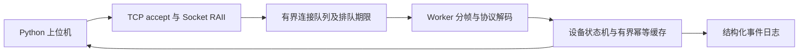

# TCP 运行时加固与初步基准

- Socket 所有权经 move-only RAII 对象从接入端转给队列及 Worker。入队失败时接入端保留所有权，以便回复 BUSY 后关闭连接。
- 修复永久性 recv 错误被反复重试的问题。帧上限为 64 KiB，等待下一完整帧的预算为 5 秒。发送设置 250 ms 单次系统调用超时。
- 设备共享锁仍覆盖缓存查询、状态执行及响应入账，避免并发检查与执行间出现窗口。代价是设备操作串行化。
- Linux 可通过 `-DEDGE_ENABLE_TSAN=ON` 单独构建。此处未运行 TSan。

## 初步测量

Windows 11、MSVC 14.43、Release、本机回环。使用程序默认 4 Worker、32 队列位，一次运行，4 客户线程执行 1,000 次状态查询，每次新建 TCP 连接。客户端耗时包含连接、请求和响应。

| 成功 | 成功请求/秒 | P50 | P95 | P99 |
|---:|---:|---:|---:|---:|
| 1,000/1,000 | 1,412.35 | 0.516 ms | 14.223 ms | 21.697 ms |

启动服务器后执行 `python benchmarks/run_benchmark.py --clients 4 --requests 1000`。本结果为状态查询基线。待补线程数和队列矩阵、CPU/RSS/FD、混合负载、长期运行及 C++ 覆盖率。
# V2.0 研发增量

核心模块：[连接和 Worker](../cpp/src/main.cpp)、[有界队列](../cpp/include/edge/bounded_queue.hpp)、[设备状态机](../cpp/src/state_machine.cpp)、[协议编解码](../cpp/src/protocol.cpp)。

面试准备：解释 TCP 半包与粘包、有界队列满与排队超期的不同处理、Socket 所有权转移、请求 ID 与指纹冲突、FIFO 驱逐之后的幂等边界，以及如何解读前后压测。

基准提交 `7aa038c`。服务器在同一把设备互斥锁内检查请求 ID、执行命令并写回结果，避免并发请求重复触发设备动作。缓存采用 1024 条 FIFO，命中不延长保留时间。驱逐或进程重启后，同一 ID 可能重新执行，调用方遇到未知结果应查状态。设备事件写入日志后清除内存副本，单次命令的事件集中刷新一次。

Bad Case：唯一请求持续进入时，旧实现长期保留应答和设备事件。V2 对这两类常驻数据施加上界。根据代码检查，将请求指纹计算移出设备锁，也删除了原先缓存未命中时的二次指纹计算。日志仍同步写入，磁盘文件的轮转由部署侧负责。

Windows 11 / MSVC 14.43 x64 Release 下原生 CTest 通过。4 个服务 Worker、32 个排队槽、4 个压测客户端，每轮 1000 次 TCP 新连接查询，三轮全部成功。三轮分别为 1997.78、1148.27、1121.69 次成功请求/秒，P95 分别为 11.68、15.44、15.13 ms。记录见 [压测输出](../benchmarks/windows-v2-results.txt)。

上一轮的 1412.35 次/秒保留为早期单次测量，正式对照见下节。
## 排队期限与控制命令基准

新增 `--queue-timeout-ms`，默认 2000 ms，从 TCP accept 时计算。Worker 取任务时检查期限，过期响应 `QUEUE_TIMEOUT` 并关闭连接，命令不会进入设备核心。一个 Worker 被半帧占用时，第二条连接超过 100 ms 等待期限。Windows TCP 实测返回 [QUEUE_TIMEOUT](../benchmarks/windows-queue-deadline.json)。

`benchmarks/run_benchmark.py` 支持独立测量 `status` 和 `start_run`，后者从新进程初始化状态、加载样本数为 100 的配置后再预热。这里衡量模拟状态机与结构化事件写盘，并没有等待外部执行机构。对照负载固定为 Windows x64 Release、4 个 Worker、32 个队列槽、4 个并发客户端、100 次预热、每轮 1500 个请求。原始输出另存于 [控制和查询压测](../benchmarks/windows-control-query.json)。

V3 同机对照从提交 `7aa038c` 构建基线，以新进程交替运行旧版与当前版，每个版本、每种命令各三轮。每轮固定 30 次预热、350 次请求。共 4,200 次测量请求全部成功，RSS 与句柄快照亦保存在 [对照原始数据](../benchmarks/windows-baseline-comparison.json)。

| 命令 | 基线吞吐中位数 | 当前吞吐中位数 | 基线 / 当前的单轮 P95 中位数 |
| --- | ---: | ---: | ---: |
| `status` | 1522.0/s | 1256.8/s | 13.79 / 15.04 ms |
| `start_run` | 986.9/s | 950.2/s | 15.54 / 15.95 ms |

本轮吞吐未提升。改动的已验证收益是请求缓存有界、慢连接场景可拒绝过期任务。较长对照曾在基线预热遇到短连接失败，与并行执行的 TCP 集成测试同时出现 WinError 10048。隔离压测后完整回归为 98 项通过、1 项跳过。短测资源快照对长期内存趋势的证明有限，Linux Sanitizer 的当前版本结果仍待 CI。
