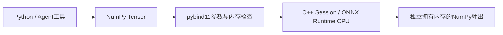

# Edge AI Inference SDK：跨语言模型执行接口

Python应用通过NumPy输入调用C++17封装的ONNX Runtime CPU Session。Tokenizer和业务检索留在Python侧，SDK负责模型元数据、Tensor契约、原生执行和异常转换。



## 核心设计

- Session独立持有Env和SessionOptions，析构顺序保证Session先于Env释放。
- 输入明确接受C-contiguous float32/int64，检查输入名、rank与固定维度；拒绝隐式类型转换。
- 调用期间保留NumPy对象引用；只在原生Run范围释放GIL。
- 输出复制到Python拥有的数组，避免ORT临时结果析构后悬空。
- ORT异常映射为InferenceError；调用参数错误为ValueError。

## 当前交付状态

2026-11-19 Windows/MSVC原生构建、Wheel安装和参考图执行通过。使用NuGet微软官方1.22.0原生库；Python对照ORT为1.32.0，版本不同已显式记录。

实际结果：[原始记录](benchmarks/windows-reference.json)。batch=2，预热10次、测量100次，最大绝对输出误差0；dtype、shape与stride三类非法输入均被拒绝。小计算图端到端SDK调用P50=0.0075ms、P95=0.00791ms；不能外推为Embedding模型或芯片硬件性能。

预训练BGE中文模型已完成原生执行与Python ORT对齐；真实LLM、C++设备与原生知识检索工具完整链路已运行完成。[联合轨迹](https://github.com/KristenYue/telecom-network-incident-agent/blob/main/docs/evidence/native-llm-live.json)包含两次工具调用，知识工具后端为native_onnx。Ubuntu构建尚未验收。

全新虚拟环境只安装NumPy和构建出的Wheel，未安装Python ORT、Torch或Transformers，参考图执行与NumPy预期输出误差为0。[干净安装证据](benchmarks/windows-clean-install.json)。SDK原生DLL随Wheel安装，不依赖开发目录中的DLL。Embedding扩展仍需要独立安装分词依赖。

## 预训练模型实测

使用本机已有 `BAAI/bge-small-zh-v1.5` 缓存，snapshot为 `7999e1d3359715c523056ef9478215996d62a620`。导出CLS+L2归一化ONNX，输入动态batch/sequence，Python侧分词、截断至256 token。模型文件不提交仓库；复现者需遵守上游许可并取得对应权重。

[实际记录](benchmarks/windows-bge.json)：batch=3、sequence=15、输出3×512，最大绝对误差1.53e-7；单线程、预热5次、重复30次，不含分词。C++ SDK P50/P95=13.33/14.86ms，Python ORT=12.69/14.15ms。本轮原生SDK没有速度优势，其价值为跨语言契约与设备/Agent集成。

`examples/export_embedding.py`提供导出；`examples/verify_embedding.py`提供对齐与测量；`edge_ai_sdk.embedding.NativeEmbedder`直接符合知识库Embedder接口。输入数组在原生执行期间不得被其他线程修改。

工业Agent设置 `EDGE_AI_MODEL_PATH`、`EDGE_AI_TOKENIZER_PATH` 后，已有 `search_equipment_runbook` 工具使用原生推理；配置不完整或模型不可用时明确失败，不静默伪装为语义检索。此次已执行独立工具验收，不将其冒充真实LLM完整调用。

环境Bad Case：导出环境混入SDK环境NumPy时出现本机SciPy版本警告，导出和ORT验收仍执行成功；正式干净环境应独立安装，避免混合site-packages。

## Windows构建

使用官方ONNX Runtime CPU C/C++发行包，解压后包含include与lib：

```powershell
.\inference_sdk\build_windows.ps1 -OrtRoot <官方发行包解压目录>
.\.venv-sdk\Scripts\python.exe inference_sdk/examples/verify_session.py --output inference_sdk/benchmarks/windows-reference.json
```

接口：

```python
from edge_ai_sdk import InferenceSession
session = InferenceSession('model.onnx')
print(session.model_info())
outputs = session.run({'input': input_array})
```

`verify_session.py`生成一个真实可执行ONNX参考计算图，用于ABI、数值对齐、错误输入与输出生命周期验收；它不是预训练Embedding模型，不能作为语义检索质量证据。预训练模型接入、Ubuntu构建、Agent工具接入仍为待交付项。

## 工程日志

2026-11-19：建立独立包，避免修改现有设备Runtime；安装Python构建依赖。官方1.23.2发行包请求返回404，改用可核查的官方发行版本继续准备。无NPU/GPU、量化、自研算子或芯片性能声明。

GitHub发行下载连接重置后，改用微软官方NuGet Microsoft.ML.OnnxRuntime 1.22.0，提取头文件与win-x64原生库，成功构建安装。输入对象在Run期间保持引用，输出复制后Session销毁仍可读取；参考验证脚本已实际检查。
