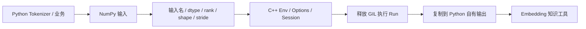
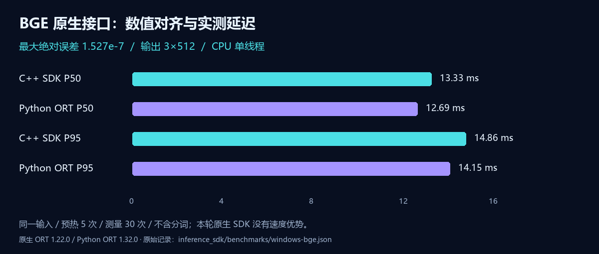

# Edge AI Inference SDK｜C++ / Python 原生模型执行接口

[返回项目总览](../README.md) · [联合应用](https://github.com/KristenYue/telecom-network-incident-agent/blob/main/docs/evidence/native-llm-live.json) · [Ubuntu 验收](https://github.com/KristenYue/edge-device-verification-lab/actions/runs/44506857643)

**C++17 · pybind11 · ONNX Runtime CPU · NumPy · CMake / scikit-build-core**

Python 应用通过 NumPy 调用 C++ 封装的 ONNX Session。分词与业务编排留在 Python；SDK 管理模型元数据、Tensor 输入契约、原生执行、输出所有权和异常转换。上层知识工具直接使用 `NativeEmbedder`，形成模型接口到业务应用的证据链。

## 接口与生命周期



| 关键设计 | 实现与原因 |
|---|---|
| Session 资源所有权 | Session 独立持有 Env 与 Options，确保析构依赖顺序；不依赖 Python 临时对象维持原生会话 |
| Tensor 严格契约 | 接受 C-contiguous `float32 / int64`，校验输入名、rank、固定维度；拒绝隐式类型转换 |
| GIL 与输入生命周期 | Run 调用期间保留 NumPy 所有者引用，只在原生执行段释放 GIL；调用者不得并发修改输入 |
| 输出生命周期 | 结果复制到 Python 拥有的数组，Session 或 ORT 临时输出销毁后仍可读 |
| 异常边界 | 参数错误为 `ValueError`，ORT 执行错误映射 `InferenceError` |
| 可安装交付 | Wheel 携带运行库，Windows / Linux 干净环境独立安装执行；Linux 补齐 SONAME 别名 |

## 预训练 BGE 实测

模型 `BAAI/bge-small-zh-v1.5`，snapshot `7999e1d3359715c523056ef9478215996d62a620`，CLS + L2 归一化，ONNX 动态 batch / sequence；Python 分词截断 256 token。

| 项目 | C++ SDK | Python ORT | 口径 |
|---|---:|---:|---|
| 输出形状 | 3×512 | 3×512 | 输入 3×15 |
| 最大绝对误差 | **1.527×10⁻⁷** | 参考 | 数值对齐 |
| P50 | 13.33 ms | 12.69 ms | 单线程，预热 5 次、测量 30 次 |
| P95 | 14.86 ms | 14.15 ms | 不含分词 |

[原始数据](benchmarks/windows-bge.json)。原生 ORT 1.22.0、Python ORT 1.32.0。本轮没有获得提速；交付价值是**跨语言契约、生命周期安全、可安装接口和业务集成**。



## 从组件到应用的证据

| 层次 | 结果 | 证据 |
|---|---|---|
| 参考计算图 | 与 NumPy 最大误差 0；dtype / shape / stride 非法输入拒绝；输出不依赖 Session 存活 | [Windows 参考验证](benchmarks/windows-reference.json) |
| 干净安装 | 只安装 NumPy 和 SDK Wheel，无 Python ORT / Torch / Transformers，参考图误差 0 | [Windows 干净环境](benchmarks/windows-clean-install.json) |
| Ubuntu Wheel | 编译、参考图执行、独立虚拟环境安装成功 | [Linux CI](https://github.com/KristenYue/edge-device-verification-lab/actions/runs/44506857643) |
| 预训练模型 | BGE 原生执行与 Python ORT 对齐 | [BGE 记录](benchmarks/windows-bge.json) |
| 业务工具 | NativeEmbedder 接入知识库，保存来源、版本与后端标记 | [检索记录](https://github.com/KristenYue/telecom-network-incident-agent/blob/main/docs/evidence/native-retrieval.json) |
| 真实模型联合链路 | LLM 查询 C++ 设备，再调用原生 ONNX 知识工具并生成诊断 | [联合轨迹](https://github.com/KristenYue/telecom-network-incident-agent/blob/main/docs/evidence/native-llm-live.json) |

## 构建与运行

在仓库根目录执行；先取得官方 ONNX Runtime CPU C/C++ 包，目录包含 `include/` 与 `lib/`。

```powershell
.\inference_sdk\build_windows.ps1 -OrtRoot <ORT发行包目录>
.\.venv-sdk\Scripts\python.exe inference_sdk/examples/verify_session.py --output .runtime/sdk-reference.json
```

Linux 使用同一 CMake / Wheel 工程，完整可执行命令见 [Linux 构建流程](../.github/workflows/inference-sdk.yml)。

```python
from edge_ai_sdk import InferenceSession
session = InferenceSession("model.onnx")
print(session.model_info())
outputs = session.run({"input": input_array})
```

[模型导出](examples/export_embedding.py) · [BGE 对齐与时延](examples/verify_embedding.py) · [干净安装验证](examples/verify_installed_wheel.py) · [原生源码](bindings/session.cpp)

Agent 联合演示需设置 `EDGE_AI_MODEL_PATH`、`EDGE_AI_TOKENIZER_PATH` 和模型服务环境变量，执行业务仓库 `scripts/demo_native_llm.py --simulator <设备可执行文件> --output <结果.json>`。模型权重独立取得，不随代码包发布。

## 工程复盘

Linux Wheel 的原生库存在 SONAME 运行时查找问题：编译通过不代表干净环境能加载。通过安装库别名并在全新虚拟环境执行参考图，验证完整打包路径。Windows 依赖通过微软官方 NuGet 取得，避免开发机隐式 DLL 路径掩盖缺失依赖。

当前后端为 CPU Execution Provider；NPU / GPU、量化与自研算子属于不同适配范围。本页不将参考图延迟解释为预训练模型或目标芯片性能。


---

文档与结果口径：2026-11-19。功能以对应源码和运行记录为准；场景、执行环境和数据来源随结果一并标注。
